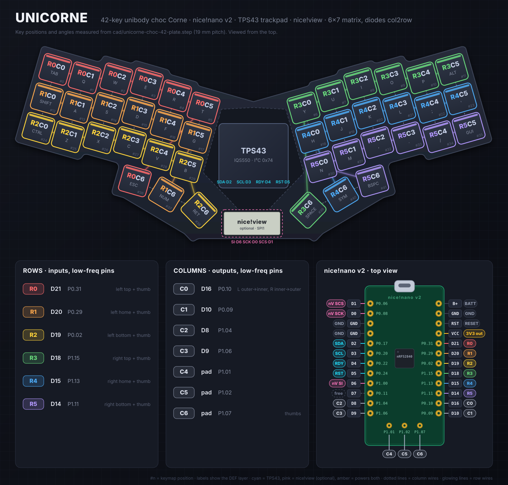

# Unicorne ZMK config

A unibody, handwired 42-key choc Corne with an Azoteq TPS43 trackpad in the middle,
driven by a single **nice!nano v2**.



The CAD source is `cad/unicorne-choc-42-plate.step` (top case, bottom plate, trackpad mount).
Key positions, angles, the physical layout and the diagram above all come from it.

- Shield: `unicorne` (`boards/shields/unicorne`)
- Trackpad driver: [AYM1607/zmk-driver-azoteq-iqs5xx](https://github.com/AYM1607/zmk-driver-azoteq-iqs5xx). Upstream ZMK has no IQS5xx driver.
- ZMK Studio: enabled. Use the USB connection; `&studio_unlock` is on the SYS layer, bottom-left key.
- Layers: DEF, NUM, SYM, SYS, SCRL, SNYP.
- Keymap editor: `config/unicorne.json` + `config/unicorne.keymap` work with
  <https://nickcoutsos.github.io/keymap-editor/>. Point it at this repo.
- GitHub Actions builds on every push. Download the `firmware` artifact from the Actions run.

## Matrix (6 rows x 7 cols, 13 pins)

Diodes are **col2row**: the diode stripe (cathode) faces the **row** wire.

The matrix uses only the nRF52840 pins marked "low frequency I/O only". That leaves the
full-speed pins for the trackpad's I2C bus.

| Signal | nice!nano pin | GPIO  |
|--------|---------------|-------|
| ROW0   | D21           | P0.31 |
| ROW1   | D20           | P0.29 |
| ROW2   | D19           | P0.02 |
| ROW3   | D18           | P1.15 |
| ROW4   | D15           | P1.13 |
| ROW5   | D14           | P1.11 |
| COL0   | D16           | P0.10 |
| COL1   | D10           | P0.09 |
| COL2   | D8            | P1.04 |
| COL3   | D9            | P1.06 |
| COL4   | middle pad    | P1.01 |
| COL5   | middle pad    | P1.02 |
| COL6   | middle pad    | P1.07 |

P0.09 and P0.10 are NFC pins by default. The overlay sets `nfct-pins-as-gpios`.

### Key wiring

Each half has its own 3 row wires. The 7 column wires are shared by both halves.

```
 LEFT (rows 0-2)                              RIGHT (rows 3-5)
 C0  C1  C2  C3  C4  C5                        C0  C1  C2  C3  C4  C5
 R0  R0  R0  R0  R0  R0                        R3  R3  R3  R3  R3  R3
 R1  R1  R1  R1  R1  R1                        R4  R4  R4  R4  R4  R4
 R2  R2  R2  R2  R2  R2                        R5  R5  R5  R5  R5  R5
 (C0 = pinky column)                           (C0 = index inner column)

 Left thumbs (outer -> inner): R0C6 R1C6 R2C6
 Right thumbs (inner -> outer): R3C6 R4C6 R5C6
```

## Trackpad (TPS43, I2C address 0x74)

| TPS43 | nice!nano  | GPIO  |
|-------|------------|-------|
| SDA   | D2         | P0.17 |
| SCL   | D3         | P0.20 |
| RDY   | D4         | P0.22 |
| RST   | D5         | P0.24 |
| VDD   | VCC (3.3V) |       |
| GND   | GND        |       |

D0, D1, D6 and D7 are full-speed pins and are still free.

### Adding a nice!view later

A nice!view needs 3 pins (SCK, MOSI, CS), and D0, D1, D6 and D7 are free. The stock
`nice_view` shield uses D15/D16, which this matrix already uses. You'll need to remap its
SPI pins in a pinctrl override, for example SCK=D0 (P0.08), MOSI=D6 (P1.00), CS=D1 (P0.06).

The nice!nano switches VCC off through P0.13 when external power is off (`&ext_power EP_OFF`).
Keep external power on, or the trackpad loses power.

On the NUM layer, hold `SCRL` (the G position) to turn trackpad movement into scrolling.
Hold `SNYP` (the A position) for precise, slow movement. Trackpad gestures:
one-finger tap = left click, two-finger tap = right click, press-and-hold = drag,
two-finger swipe = scroll.

## Building locally

```sh
west init -l config && west update
west build -s zmk/app -d build/unicorne -b nice_nano@2.0.0//zmk -S studio-rpc-usb-uart -- \
  -DSHIELD=unicorne -DZMK_CONFIG=$PWD/config -DZMK_EXTRA_MODULES=$PWD -DCONFIG_ZMK_STUDIO=y
```

Flash `build/unicorne/zephyr/zmk.uf2` by double-tapping reset and copying the file to the `NICENANO` drive.
